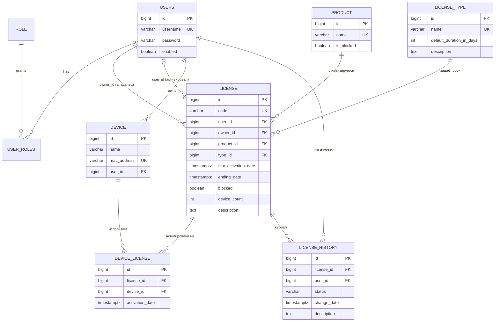
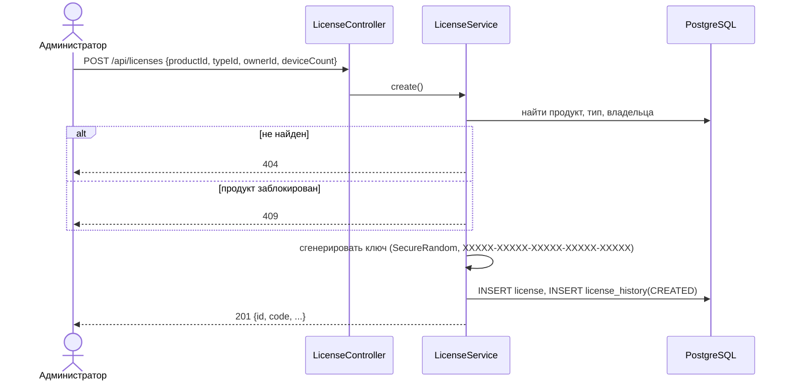
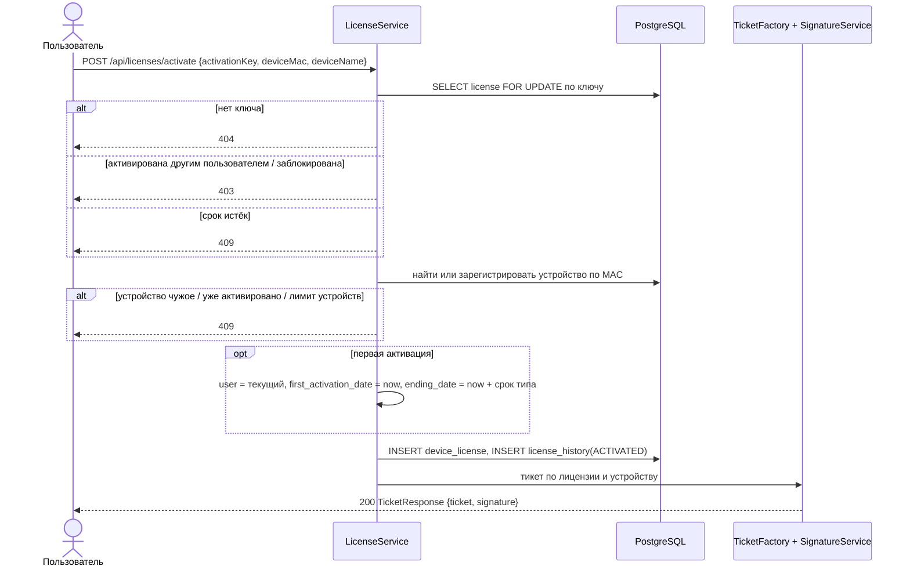
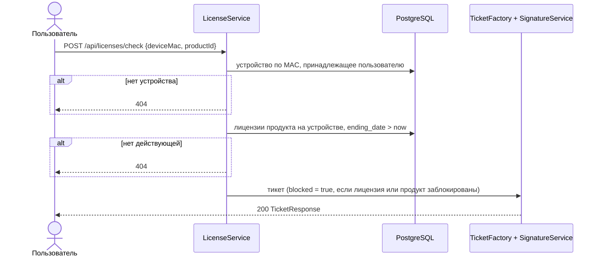
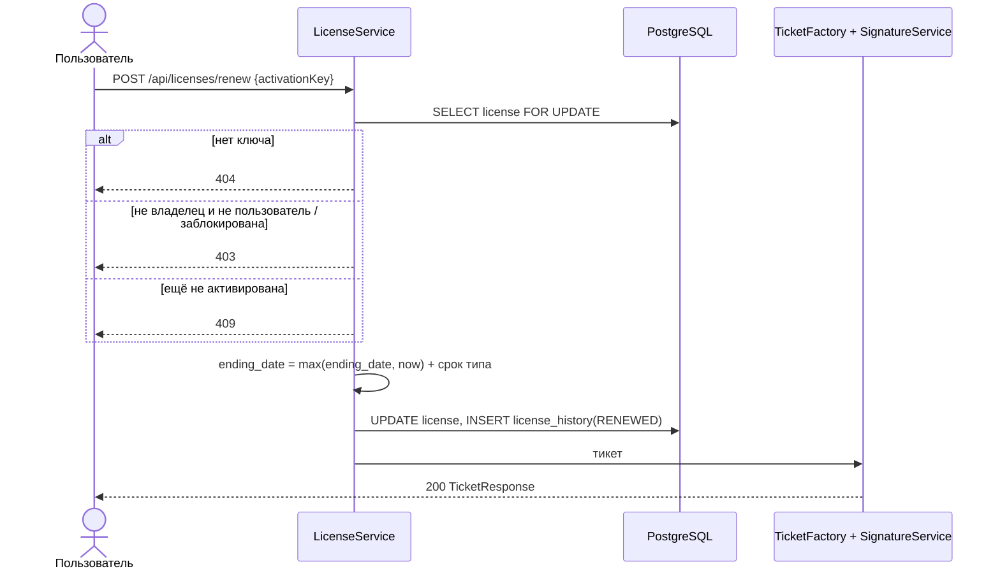

# Схемы модуля лицензий

## ER-диаграмма

Текстовое описание:

- **product**: лицензируемый продукт. Если `is_blocked = true`, на продукт не выдаются новые лицензии, а в тикетах ставится флаг блокировки.
- **license_type**: тип лицензии. Поле `default_duration_in_days` задаёт срок действия при активации и шаг продления.
- **license**: лицензия с уникальным ключом активации `code`.
  - `owner_id`: владелец (покупатель), задаётся при создании.
  - `user_id`, `first_activation_date`, `ending_date`: пустые до первой активации.
  - `device_count`: сколько устройств можно активировать.
  - `blocked`: блокировка лицензии администратором.
- **device**: устройство пользователя. MAC-адрес уникален и хранится в виде `AA:BB:CC:DD:EE:FF`.
- **device_license**: связь «многие ко многим» между лицензией и устройством, с датой активации. Пара (лицензия, устройство) уникальна.
- **license_history**: журнал изменений: CREATED, ACTIVATED, RENEWED. Для каждой записи хранится пользователь и время.
- **users, role, user_roles, user_sessions**: пользователи, роли и refresh-сессии, перенесены из прошлого проекта.

Схема создаётся миграцией Flyway `src/main/resources/db/migration/V1__init.sql`. Hibernate только сверяет сущности со схемой (`ddl-auto: validate`).

## Диаграммы последовательности

### Создание лицензии (ADMIN)

### Активация лицензии (USER)

### Проверка лицензии (USER)

### Продление лицензии (USER)

## Тикет и ЭЦП

`Ticket` содержит следующие поля:

| Поле | Значение |
|---|---|
| `serverDate` | текущая дата сервера |
| `ticketLifetimeSeconds` | время жизни тикета |
| `activationDate` | дата первой активации лицензии |
| `expirationDate` | дата истечения лицензии |
| `userId` | идентификатор пользователя |
| `deviceId` | идентификатор устройства |
| `blocked` | флаг блокировки |

Все даты передаются в UTC с точностью до секунды.

`TicketResponse` = `{ ticket, signature }`.

Подпись формируется так:
1. Тикет сериализуется в канонический JSON (`CanonicalJson`): ключи по алфавиту, без пробелов, UTF-8, даты в ISO-8601.
2. Канонический JSON подписывается алгоритмом SHA256withRSA приватным ключом из PKCS12-хранилища (`SigningKeyLoader`, `SignatureService`).
3. Подпись кодируется в Base64.

Проверка на стороне клиента:
1. Получить сертификат: `GET /api/signature/certificate`, доступ открытый.
2. Пересобрать канонический JSON из полученного `ticket`, например `jq -cS .ticket`.
3. Проверить подпись открытым ключом сертификата, например `openssl dgst -sha256 -verify`.

Такая проверка выполняется в тестах (`LicenseFlowTests`) и в CI.

Компоненты модуля ЭЦП (пакет `licenseserver.signature`):
- `SignatureProperties`: путь к хранилищу, пароль, алиас и алгоритм; задаются переменными окружения.
- `SigningKeyLoader`: загружает ключ и сертификат при старте и проверяет срок действия сертификата. Также проверяет, что ключ соответствует сертификату: подписывает пробные данные и проверяет подпись.
- `CanonicalJson`: детерминированная сериализация.
- `SignatureService`: подпись, проверка, выдача сертификата в формате PEM.
- `TicketFactory`: сборка тикета и подписание.
